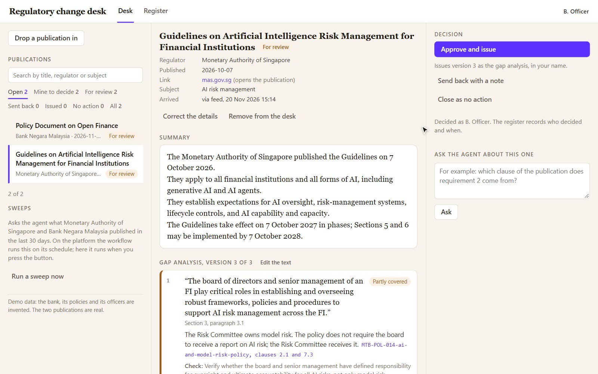

# Katonic Case Desk

One screen for a person who works through cases with an AI agent. The case is
on the left, the agent's draft is in the middle, the person's decision is on
the right, and every decision lands in a register.

The agent drafts. A person decides. The desk records who decided what, and
when.

It is a small web app on the [Katonic](https://katonic.ai) agent API. The
configuration shipped here is the **regulatory change desk**: a regulatory
publication comes in, the Regulatory Monitoring Agent drafts a gap analysis
against the bank's policy library, and a compliance officer approves it,
edits it, sends it back with a note, or closes it as no action.



The bank, its policies and its officers are invented. The two publications in
the demo are real.

## What it does

- **Takes publications in** by hand, by webhook from a feed, or from a sweep
  that asks the agent what a regulator has published.
- **Shows the agent's draft** as a summary and a table of requirements, each
  marked covered, partly covered, not covered, or not found in the library,
  with the policy clause it rests on. The marks are the agent's reading. The
  officer decides.
- **Lets the officer ask the agent** about the case, on the same session, so
  the agent has the publication and the draft in front of it.
- **Keeps four eyes.** The person who dropped a publication in cannot decide
  it.
- **Takes the decision**: approve and issue, edit the text, send back with a
  note, or close as no action. A sent-back case takes no decision until the
  agent has drafted again, and the new draft carries the officer's note.
- **Keeps the register**: who decided, when, which version of the draft, and
  the agent session. It exports as CSV.

## Try it without Katonic

You need Node.js 20 or later.

```bash
npm install
cp .env.example .env
```

Set these three lines in `.env`:

```
KATONIC_BASE_URL=http://localhost:8390
KATONIC_API_KEY=kapi_fake
KATONIC_AGENT_ID=fake
```

Then, in two terminals:

```bash
node demo/fake-platform.js    # a stand-in for the agent API
```

```bash
npm run seed                  # the two demo publications
npm start                     # http://localhost:3000
```

The stand-in answers with canned text that says it is canned. It shows the
screen and the flow. It is not a gap analysis.

## Run it with a real agent

You need a Katonic installation. [platform/README.md](platform/README.md) has
the steps:

1. Build the agent from [platform/agent-instructions.md](platform/agent-instructions.md).
2. Load a policy library: the three invented policies in `demo/policies/`, or
   your own.
3. Create an API key.
4. Deploy this repository through App Studio, with a Storage dataset attached
   for the desk's records.

## Make it another desk

Almost everything that makes this the regulatory change desk is in
[desk.config.json](desk.config.json): what a case is called, the intake form,
what the agent is asked for, which decisions exist, and what the register
records. The server and the page read it.

The desk was built to serve other case-shaped work the same way, such as
sanctions alert review, complaint handling or payment investigation. Only the
regulatory change configuration ships today, and the sweep feature still
speaks of regulators in the code.

## Settings folders kept outside the repository

A desk is a settings folder. It does not have to live in this repository. A
folder anywhere on the laptop or the server will do.

**Where the desk is.** Set `DESK_CONFIG` to the full path of the folder's
`desk.config.json`, for example
`C:\desks\third-party-risk\desk.config.json`. A relative path is read from
this folder. The demo cases named in the settings are read from the same
folder.

**Where its policy library is.** Set `DESK_LIBRARY_DIR` to a folder of
Markdown files. Use a full path here too. The desk hands the agent the files
that best match each case.

**Replies for the stand-in.** The stand-in platform (`demo/fake-platform.js`)
answers with canned text. A settings folder can carry its own canned replies in
a file `demo-replies.json`, beside `desk.config.json`:

```json
{
  "replies": {
    "Larkspur": "Summary\n...the full reply, table and last line...",
    "tessaly": "..."
  },
  "default": "optional reply for any other case"
}
```

Each key is a distinctive part of a case's title. Case does not matter. The
value is the full reply the stand-in gives for a draft request about that case.
Write it in the shape the desk expects, so the table and the last line are read
as marks. The stand-in adds its own first line saying that the reply is canned.
Start the stand-in with the same `DESK_CONFIG` as the desk:

```bash
DESK_CONFIG=C:/desks/third-party-risk/desk.config.json node demo/fake-platform.js
```

With no file, or with no `DESK_CONFIG`, the stand-in answers as it always did.

**One key file for many desks.** The desk reads `KATONIC_BASE_URL`,
`KATONIC_API_KEY` and `KATONIC_AGENT_ID`. A file named by `DESK_ENV_FILE`
overrides the process environment, key by key. If two desks share one key file,
set `DESK_AGENT_ID` in the process environment of each. It is the agent the
desk calls, whatever `KATONIC_AGENT_ID` says in any file. A file cannot
override it. Nothing else about the order changes.

**Several agents behind one desk.** Add an optional `routing` key to
`desk.config.json`. It picks the agent and the drafting instruction by the
value of one intake field:

```json
"routing": {
  "field": "kind",
  "kinds": {
    "Application pack": { "agentEnv": "PACK_AGENT_ID", "instruction": "Check the application pack..." },
    "Credit memo": { "agentEnv": "MEMO_AGENT_ID", "instruction": "Draft a credit memo..." }
  }
}
```

`field` is the key of an intake field. Each kind names the environment
variable that holds the agent id to call, and the instruction to use in place
of `draft.instruction`. Either can be left out. The table shape and the marks
stay the desk's own. A case whose value is not in the map uses the desk's agent
and instruction. If a kind names a variable that is empty, the draft fails with
a message that says which one to set. Questions about a case go to the same
agent that drafted it. The page shows the kind with the case's other details.
With no `routing` key nothing changes. The stand-in does not know about agents:
its replies come from `demo-replies.json`.

## What is real and what is a stand-in

| Piece | State |
|---|---|
| A publication arrives by hand, by webhook, or from a sweep | Real. The sweep asks the agent what a regulator published and parses its reply into lines the officer can open as cases. The parse is a convenience, not a guarantee |
| The agent's summary and gap analysis | Real, through `POST /public/v1/chat` to the published agent, streamed and assembled. What it finds depends on the policy library and the search tool the agent has. A draft that is not a table is shown as text |
| Send back, redraft, ask the agent | Real, on the same platform session as the draft |
| Approve, edit, send back, close as no action | Real in the desk. An edited draft is recorded as a new version by the officer |
| The register | Real, in the desk's own records |
| The officer's name | A stand-in (`LOCAL_USER`) unless the desk is told to trust the platform's sign-in headers. Every register row says which it was. See [platform/README.md](platform/README.md) |
| The platform's own approval step | Not used. The desk's register is the record. `platform/workflow.regulatory-change-desk.json` is a starting point for the same flow as a Katonic workflow agent; the desk does not call it |
| Sweeps on a schedule | Not wired. The sweep runs when the officer presses the button |
| The bank and its policy library | Invented (Meridian Trust Bank, three policies in `demo/policies/`) |

## Records

The desk keeps cases, sweeps and the register in one of two places:

- **A JSON file.** In `DATA_DIR` when it is set. On Katonic, in a folder on
  the Storage dataset attached to the app, so the records outlive a restart.
  Written whole on every change, which suits a desk with hundreds of cases.
- **PostgreSQL**, when `DATABASE_URL` is set. Two tables, created on first
  start.

`GET /api/health` says where the records are and whether a restart loses them.

## Security

- **This is code you deploy into your own installation.** Read it, or fork
  it, before you do.
- **The API key speaks for its owner.** Give it the Chat scope only, plus
  Knowledge search when the desk searches the library itself. Create it as
  the identity the desk should act as.
- **The desk calls one address**: your `KATONIC_BASE_URL`. The page loads no
  script, font or style from anywhere else.
- **Identity.** The desk believes the sign-in headers only when
  `TRUST_SIGN_IN_HEADERS=true`. Turn that on only where nothing can reach the
  app except through the platform's sign-in step.
- **Intake by webhook is off** until `INTAKE_TOKEN` is set. The feed sends it
  as `X-Intake-Token`.

## Layout

```
server.js            the API and the page shell (no framework, no build step)
app.js               the page, React without JSX
desk.css             the look
desk.config.json     what makes this desk the regulatory change desk
lib/cases.js         the rules: intake, four eyes, decisions, the register entry, the issued document
lib/agent.js         the Katonic agent API, streamed and assembled
lib/identity.js      who is signed in, and whether the headers are believed
lib/store.js         records: a JSON file, or PostgreSQL when DATABASE_URL is set
demo/                the two publications, the invented bank's policies, the seed, the stand-in agent API
platform/            running the desk on Katonic: the steps, the agent's instructions, a workflow
test/                node:test, including the desk end to end against a fake platform
```

## API

| Route | What |
|---|---|
| `GET /api/health`, `/api/config`, `/api/me` | State, the desk's configuration, who is signed in |
| `GET /api/cases`, `GET /api/cases/:id` | The cases |
| `POST /api/cases` | An officer drops a publication in (drafts at once unless `draft: false`) |
| `POST /api/intake` | The feed sends one (`X-Intake-Token`) |
| `PATCH /api/cases/:id`, `POST /api/cases/:id/remove` | Correct the details, or remove a wrong entry with a note |
| `POST /api/cases/:id/draft` | Ask the agent to draft (again) |
| `POST /api/cases/:id/decision` | `{decision, note, draft}`: approve, send_back, no_action |
| `POST /api/cases/:id/chat` | Ask the agent about this case |
| `GET /api/cases/:id/issued.md` | The issued document |
| `GET /api/sweeps`, `POST /api/sweeps`, `POST /api/sweeps/:id/open` | Sweeps |
| `GET /api/register`, `GET /api/register.csv` | The register |

## Tests

```bash
npm test
```

The tests use Node's own test runner and no network. They include the desk
end to end against a fake platform.

## Licence

Apache License 2.0. See [LICENSE](LICENSE) and [NOTICE](NOTICE).
