# Run the desk on Katonic

You need a Katonic installation, a model the agent can use, and, for the
policy library, an embedding model registered in AI Gateway.

To deploy from Git, App Studio must be able to reach GitHub and the npm
registry. An installation with no outbound access cannot use that route.
The Storage-folder route in step 4 still installs the dependencies when
the app starts (`react` and `react-dom`, and `pg` only when you set
`DATABASE_URL`), and it has not been run on an installation with no
outbound access.

## 1. Build the agent

1. In Studio, create an agent from a blank chat agent.
2. Paste the text in [agent-instructions.md](agent-instructions.md) into its
   system prompt (Setup, Behavior) and choose the Reasoning model tier.

   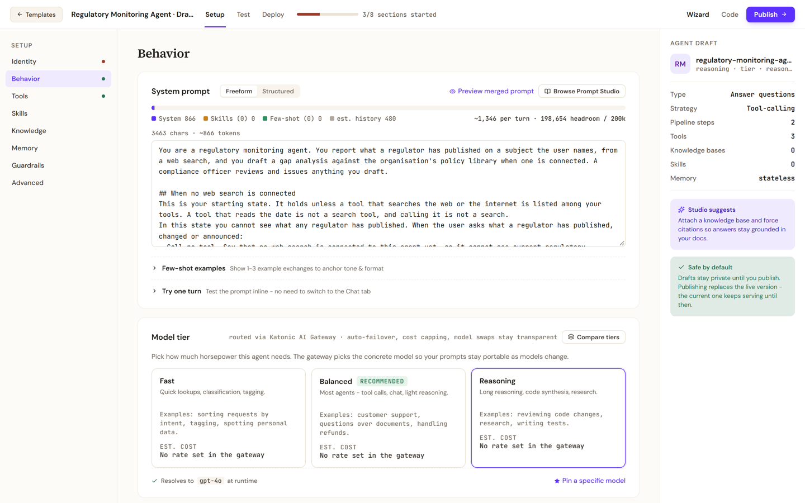

   The screenshots come from a demonstration set-up with example values.
3. Optional: attach a web search tool from Catalog, Tools. With one, a sweep
   can find what a regulator has published. Without one, the agent says it
   cannot search, and the desk still drafts a gap analysis for every
   publication you drop in.
4. Publish the agent. If Publish says an owner team is required, pick the
   team that owns the agent. Then copy the **published** agent's id. The id of the
   draft in the builder is a different id and does not answer.

   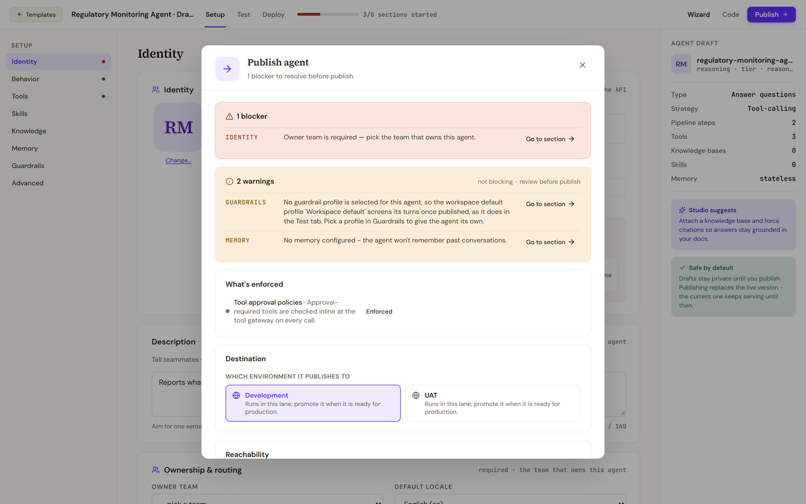
5. Check that the agent answers. This needs the key from step 3, so come
   back to it then. Put in your installation's address, the key and the
   published agent's id:

   ```bash
   curl -N -X POST "https://<your-installation>/public/v1/chat" \
     -H "Authorization: Bearer <api-key>" \
     -H "Content-Type: application/json" \
     -H "Accept: text/event-stream" \
     -d '{"agent_id": "<published-agent-id>", "messages": [{"role": "user", "content": "What can you do?"}], "stream": true}'
   ```

   This is the request the desk sends. The reply is streamed: it arrives as
   `data:` lines, the text in pieces, and ends with `data: [DONE]`. An HTTP
   error here means the address, the key or the id is wrong, and the desk
   will fail the same way.

## 2. Load the policy library

Use the three invented policies in `demo/policies/`, or your own.

- In Knowledge, choose Connect Source, then File Upload, and add the files.
  The demo names the source "Meridian policy library (invented)".

  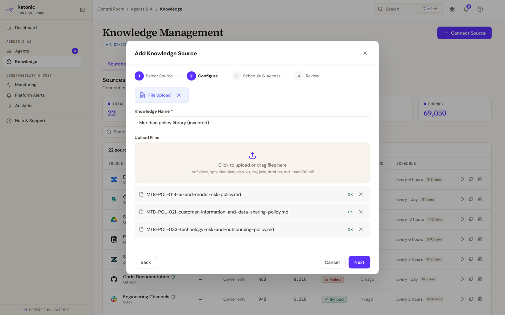

- Or run `node demo/upload-policies.js` from your machine. It uploads the
  three files through the API, waits for them to be indexed and prints the
  source's id. It needs a key with the Documents and knowledge:sync scopes.

Then connect the library in one of two ways:

- Attach the source in the agent's Knowledge section and publish again.
- Or set `KATONIC_LIBRARY_SOURCE_ID` to the source's id. The desk then
  searches the library itself and puts the passages it finds inside its
  message to the agent. That is why the agent can draft a gap analysis with
  no library attached to it.

## 3. Create an API key

Give the key the Chat scope. Add Knowledge search when you set
`KATONIC_LIBRARY_SOURCE_ID`. The key speaks for its owner, so create it as
the identity the desk should act as.

The key reaches every agent and library its owner can reach, not only this
one. For anything beyond a trial, a key owned by a service identity is the
better choice, because it does not depend on one person.

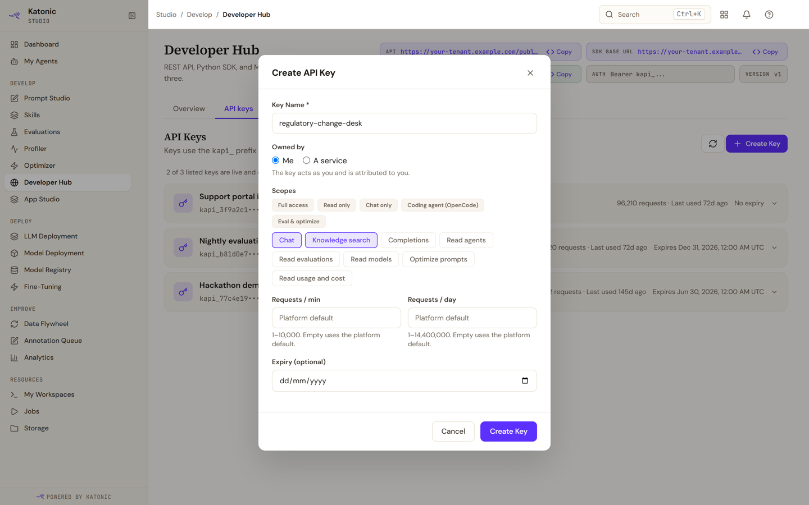

## 4. Deploy the app

First create the dataset for the desk's records. In Storage, choose New
dataset, name it, pick a size and choose its access.

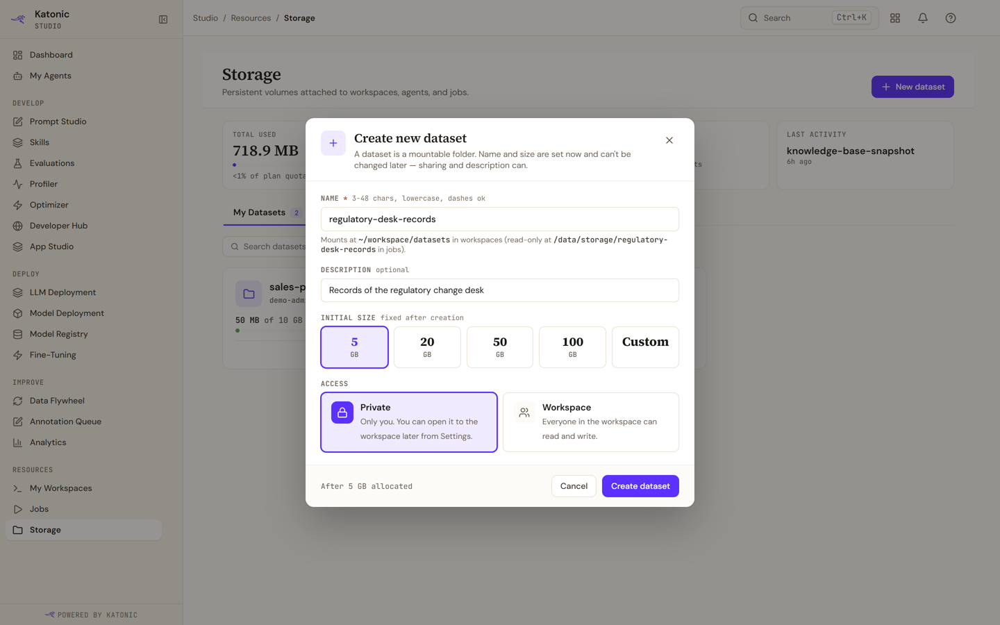

Then, in App Studio, choose New app. Give it a name that is not in use
already.

| Step | What to enter |
|---|---|
| Source | GitHub repo, `https://github.com/katonic-dev/katonic-case-desk`, branch `main`. Or copy the folder into a Storage dataset and choose "Deploy this folder" |
| Framework | Node/React. Leave the start command empty: App Studio runs `npm install`, then `npm start` |
| Main file | `server.js`. App Studio proposes `index.js` for every Node app, so change it |
| Attach dataset | A Storage dataset for the desk's records. Without one, the records are lost when the app restarts |
| Health check path | `/api/health` |
| Access | Private or Shared |

The first start takes a few minutes while the dependencies install.

`main` moves. To control what runs, fork the repository and deploy your own
fork.

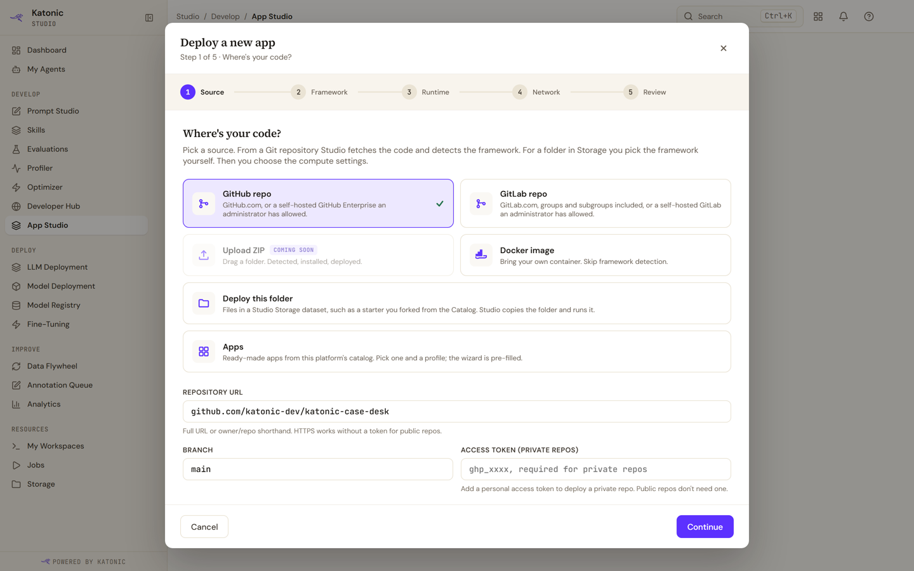

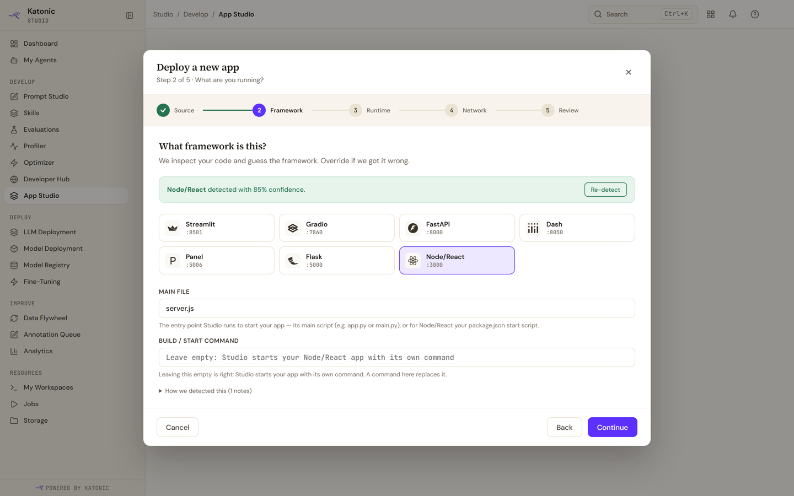

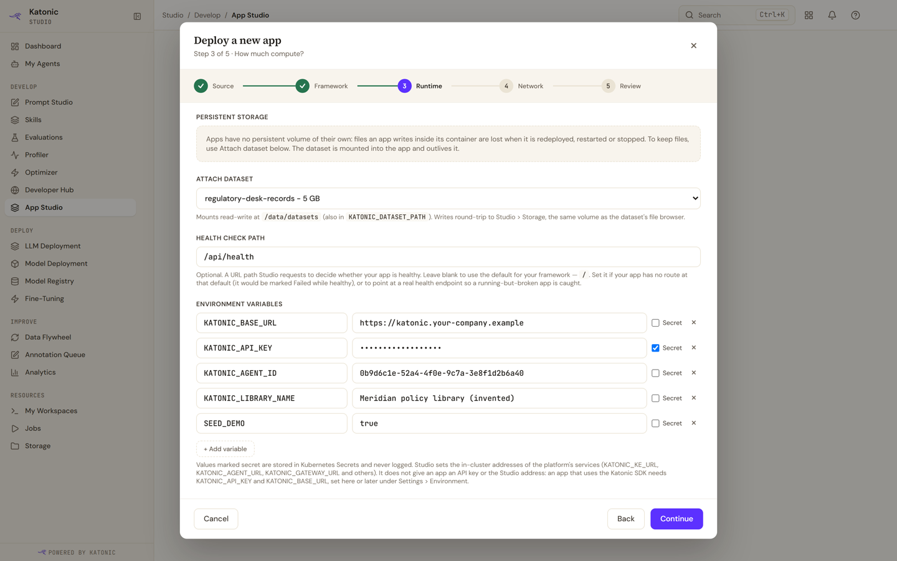

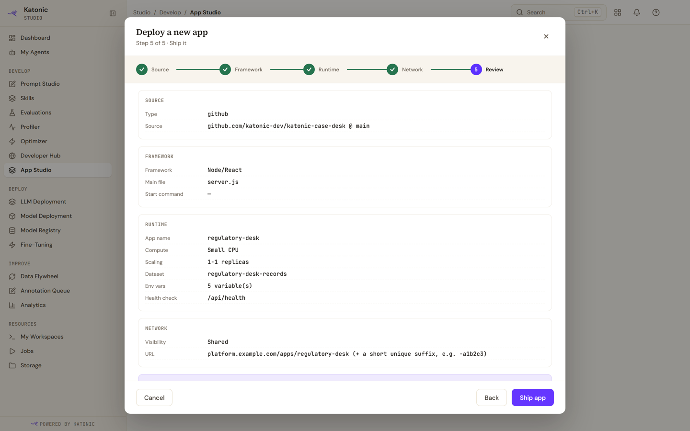

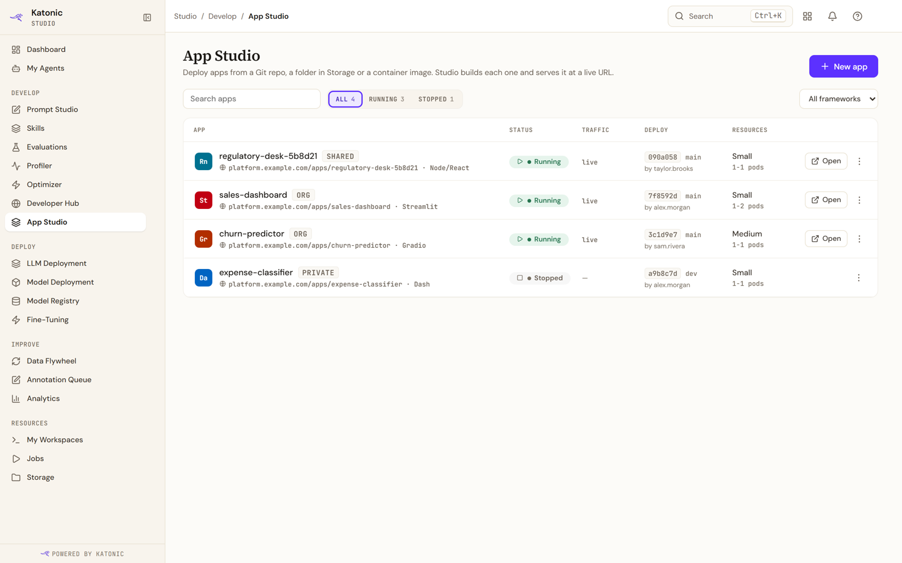

Environment variables:

| Name | Value |
|---|---|
| `KATONIC_BASE_URL` | The address of your installation |
| `KATONIC_API_KEY` | The key from step 3. Mark it as a secret |
| `KATONIC_AGENT_ID` | The published agent's id from step 1 |
| `KATONIC_LIBRARY_NAME` | The library's name, recorded on every draft and in the register |
| `KATONIC_LIBRARY_SOURCE_ID` | Optional. The source's id, when the desk searches the library itself |
| `SEED_DEMO` | Optional. `true` loads the two demo publications on the first start |
| `LOCAL_USER_NAME` | Optional. The stand-in officer's name |
| `INTAKE_TOKEN` | Optional. Turns on intake by webhook at `/api/intake` |

Leave `DATA_DIR` unset. With a dataset attached, the desk keeps its records
in a `desk-records` folder on it.

When the app is running, open `/api/health` under the app's address. It
should say `"records": "attached dataset"` and `"agent": "configured"`.

| It says | What it means | What to do |
|---|---|---|
| `"agent": "not configured: set ..."` | One or more of `KATONIC_BASE_URL`, `KATONIC_API_KEY` and `KATONIC_AGENT_ID` is empty. The line names the ones that are | Set them in the app's environment variables and start the app again |
| `"records": "local folder, lost on restart"` | No dataset is attached, and neither `DATA_DIR` nor `DATABASE_URL` is set. The desk is writing to `./data` inside the app | Attach a Storage dataset to the app, or set `DATABASE_URL`, and start the app again. Cases entered so far are not carried over |

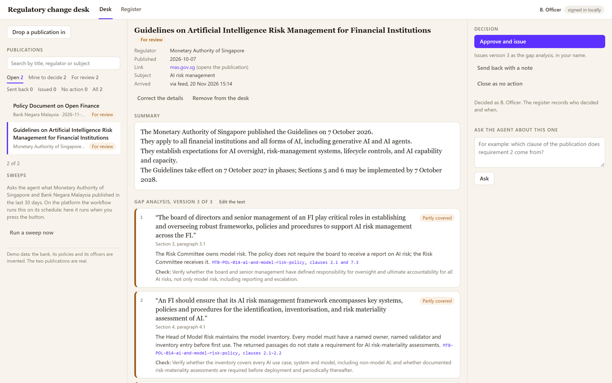

## Who is signed in

Deployed from Git or from a folder as above, the desk uses the stand-in
identity, so the register is not evidence of who decided.

App Studio puts a sign-in step in front of an app that is not public and
passes the signed-in person's email to the app in `X-Forwarded-Email`.

The desk believes that header only when `TRUST_SIGN_IN_HEADERS=true`. Turn it
on only where nothing can reach the app's port except through that sign-in
step. Anywhere else, leave it unset: the desk uses the stand-in identity from
`LOCAL_USER`, and every register row says `identity_source: stand-in`.

Four eyes needs real identities. With the stand-in identity every visitor is
the same officer: a publication dropped in by hand cannot be decided, and one
that arrived from the feed can be decided by anyone.

## A database instead of a file

Set `DATABASE_URL` to a PostgreSQL connection string. The desk creates its
two tables on first start and ignores the dataset.

## The workflow

[workflow.regulatory-change-desk.json](workflow.regulatory-change-desk.json)
is the same flow as a four-step Katonic workflow agent: in, agent, approve,
out. It is a starting point for running the flow with the platform's own
approval step and schedule. The desk does not call it: the desk calls the
agent directly and records decisions in its own register.
